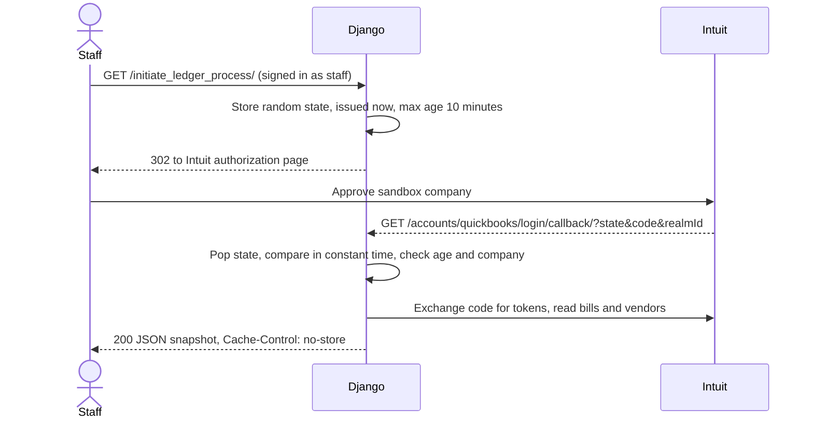

# QuickBooks sandbox connector

A small Django proof of concept that runs the Intuit OAuth 2.0 authorization flow for a QuickBooks Online sandbox company and returns a one-off JSON snapshot of bills and vendors. It is useful as a compact, tested reference for the parts of an accounting integration that are easy to get wrong: the OAuth `state` round trip, keeping tokens and provider errors server-side, and pinning a connection to an expected company.

Despite the repository name, it does **not** synchronise anything. There is no recurring job, no reconciliation, no persisted ledger data and no write-back to QuickBooks. The Django project is still called `routeable_app` after the product it was prototyped for.

## How the flow works



| File | Responsibility |
| --- | --- |
| `api/views.py` | Staff-only views, OAuth state checks, company pin, error mapping |
| `api/ledger.py` | `LedgerClient`: Intuit authorization URL, token exchange, bill/vendor reads |
| `routeable_app/settings.py` | Environment-driven settings, including the `QUICKBOOKS` block |
| `api/tests.py` | 28 offline tests; every Intuit and QuickBooks call is mocked |

## Run it

You need your own app in the [Intuit developer portal](https://developer.intuit.com/app/developer/sandbox) with a sandbox company. Register exactly this redirect URI for it:

```text
http://localhost:8003/accounts/quickbooks/login/callback/
```

### With Docker (recommended)

```sh
cp example.env .env          # then fill QBOOK_CLIENT_ID and QBOOK_CLIENT_SECRET
docker compose up --build -d
docker compose exec web python manage.py createsuperuser
```

Sign in at <http://localhost:8003/admin/> with that account, then open <http://localhost:8003/initiate_ledger_process/>. The container applies migrations on start, stores SQLite on the `sqlite-data` volume and publishes port 8003 on loopback only.

### Without Docker

Python 3.12 (see `.python-version`):

```sh
python -m venv .venv
source .venv/bin/activate
python -m pip install -r requirements.txt
cp example.env .env
python manage.py migrate
python manage.py createsuperuser
python manage.py runserver localhost:8003
```

### Configuration

| Variable | Default | Notes |
| --- | --- | --- |
| `DJANGO_DEBUG` | `False` | `example.env` turns it on for local use |
| `DJANGO_SECRET_KEY` | none | Required when debug is off; with debug on a random per-process key is used |
| `DJANGO_ALLOWED_HOSTS` | `localhost,127.0.0.1` | Comma-separated |
| `DJANGO_SQLITE_PATH` | `./db.sqlite3` | The Docker image sets `/data/db.sqlite3` |
| `QBOOK_CLIENT_ID`, `QBOOK_CLIENT_SECRET` | empty | From your Intuit app's Keys tab |
| `QBOOK_REDIRECT_URI` | empty | Must match the URI registered with Intuit |
| `QBOOK_ENVIRONMENT` | `sandbox` | Only `sandbox` or `production` are accepted |
| `QBOOK_COMPANY_ID` | empty | Optional: reject callbacks for any other company (realm) |

Keep the environment on `sandbox`. The snapshot is real financial data when pointed at a real company.

## Requests and responses

These were captured from the Docker setup above with `example.env` copied unchanged, so the Intuit credentials are empty and nothing reaches Intuit.

Anonymous users are sent to the admin login:

```http
GET /initiate_ledger_process/

HTTP/1.1 302 Found
Location: /admin/login/?next=/initiate_ledger_process/
```

A staff user with incomplete Intuit settings gets a generic error, before any SDK object is created:

```http
GET /initiate_ledger_process/

HTTP/1.1 502 Bad Gateway
Content-Type: application/json

{"error": "Accounting authorization could not be started."}
```

A callback that does not match a state issued to this session is refused without exchanging the code:

```http
GET /accounts/quickbooks/login/callback/?state=guessed&code=synthetic-code&realmId=synthetic-realm

HTTP/1.1 400 Bad Request
Content-Type: application/json

{"error": "Missing or expired authorization state."}
```

The successful path below ran the real views and the real `intuit-oauth` URL builder in an offline container. Only Intuit's discovery document, the token exchange and the QuickBooks reads were stubbed, with invented vendors; bill `1` is reported as not found (QuickBooks error 610), as it often is in a fresh sandbox.

```http
GET /initiate_ledger_process/

HTTP/1.1 302 Found
Location: https://appcenter.intuit.com/connect/oauth2?client_id=demo-client-id&response_type=code
          &scope=com.intuit.quickbooks.accounting
          &redirect_uri=http%3A%2F%2Flocalhost%3A8003%2Faccounts%2Fquickbooks%2Flogin%2Fcallback%2F
          &state=a9axKuyOH1MgLI2X...
```

```http
GET /accounts/quickbooks/login/callback/?state=a9axKuyOH1MgLI2X...&code=demo-code&realmId=9130000000000000

HTTP/1.1 200 OK
Content-Type: application/json
Cache-Control: no-store
Referrer-Policy: no-referrer

{
  "single_bill": null,
  "all_bills": [
    {"id": "145", "balance": 250.0, "vendor_name": "Harbor Paper Co."},
    {"id": "146", "balance": 0, "vendor_name": "Northwind Courier"}
  ],
  "single_vendor": {"id": "56", "balance": 250.0, "vendor_name": "Harbor Paper Co."},
  "all_vendors": [
    {"id": "56", "balance": 250.0, "vendor_name": "Harbor Paper Co."},
    {"id": "57", "balance": 0, "vendor_name": "Northwind Courier"}
  ]
}
```

Replaying the same callback URL returns `400 {"error": "Missing or expired authorization state."}`.

## Design notes

- **State is single-use.** The callback pops the stored state before comparing it, so a failed guess also burns the real value. Comparison uses `secrets.compare_digest`, and states older than ten minutes are rejected.
- **No token storage.** Access and refresh tokens live on the `LedgerClient` for one request and are then discarded, so there is no refresh lifecycle to manage. A real sync service would need encrypted token storage, rotation and revocation; that is out of scope here.
- **Provider errors stay server-side.** `AuthClientError`, `QuickbooksException` and `requests` errors become a generic 502. Other exceptions are not swallowed.
- **Missing records are `null`.** The single-record reads default to bill `1` and vendor `56`, which may not exist in your sandbox; change them in `LedgerClient`. List reads return at most 50 items and do not page.
- **QuickBooks minor version 75.** Intuit stopped serving minor versions below 75 on 1 August 2025.
- **Intuit discovery on every request.** `intuit-oauth` downloads Intuit's OpenID discovery document whenever an `AuthClient` is created, which here is once per view call. That is why the environment is limited to `sandbox`/`production`: any other value would be fetched as a URL.
- **Fail-closed settings.** Debug is opt-in, a signing key is required without it, and session and CSRF cookies are `Secure` whenever debug is off. Production would still need a real WSGI server, HTTPS, HSTS and a proper database; `manage.py check --deploy` lists what remains.

## Tests and lint

The suite uses in-memory SQLite and separate test settings (`api/test_settings.py`); never deploy with them. It needs no network.

```sh
docker compose run --rm web python manage.py test api --settings=api.test_settings
docker compose run --rm web ruff check .
```

Without Docker, install `requirements-dev.txt` and run the same two commands.

## License

MIT, see [LICENSE](LICENSE).
